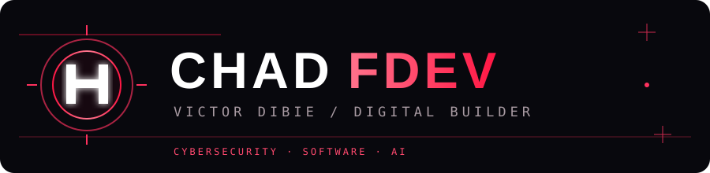
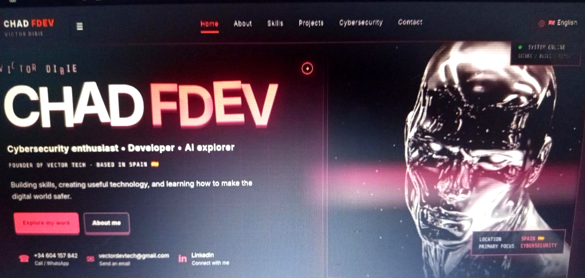
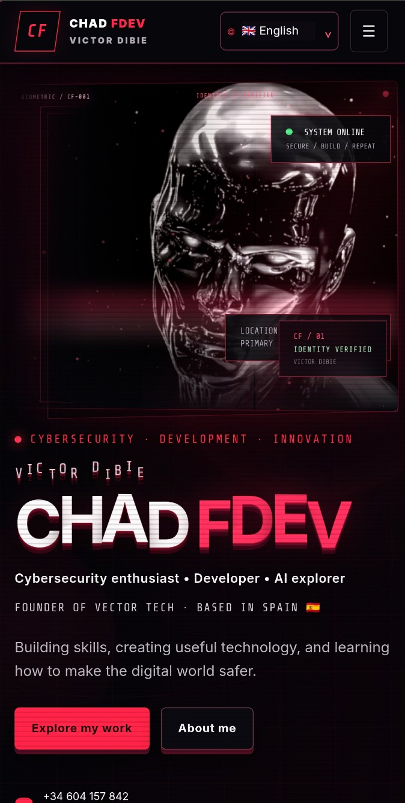

<div align="center">
  
  <p><strong>Cybersecurity · Development · Innovation</strong></p>
  <a href="https://chad-fdev.netlify.app">Live portfolio</a> ·
  <a href="https://github.com/vic-tech7">GitHub</a> ·
  <a href="https://www.linkedin.com/in/victor-dibie-dev-tech/">LinkedIn</a>
</div>

# CHAD FDEV — Personal Portfolio

Personal portfolio of Victor Dibie, also known as CHAD FDEV. I’m the founder of VECTOR TECH and I’m building my skills across cybersecurity, software development and AI.

The site uses a dark interface with red accents, motion, depth effects and a terminal-inspired section. It is built with plain HTML, CSS and JavaScript, with no framework or build process.

## Screenshots

### Desktop



### Mobile



## What’s inside

- Responsive layout and mobile navigation
- Animated intro and identity lettering
- Custom pointer for mouse devices
- Scroll effects, layered cards and canvas details
- Interactive terminal and project filters
- Six language options
- Reduced-motion and touch-device fallbacks

## Built with

- HTML
- CSS
- Vanilla JavaScript
- Canvas 2D
- SVG

The depth effects use CSS transforms and canvas. There is no WebGL dependency.

## Run it locally

There is no install step. Clone the repository and start a local server:

```bash
git clone https://github.com/vic-tech7/chad-fdev-portfolio.git
cd chad-fdev-portfolio
python3 -m http.server 8000
```

Open [http://localhost:8000](http://localhost:8000).

## Files

```text
chad-fdev-portfolio/
├── assets/
│   ├── demo/
│   │   └── chad-fdev-mark.svg
│   ├── images/
│   │   └── chad-profile-cyber.jpg
│   └── screenshots/
│       ├── desktop.png
│       └── mobile.png
├── css/
│   └── style.css
├── js/
│   ├── main.js
│   └── translations.js
├── index.html
├── robots.txt
└── sitemap.xml
```

## Links

- Website: https://chad-fdev.netlify.app
- VECTOR TECH: https://vector-tech.netlify.app
- GitHub: https://github.com/vic-tech7
- LinkedIn: https://www.linkedin.com/in/victor-dibie-dev-tech/
- Email: vectordevtech@gmail.com

## Notes

This is a front-end project, so its HTML, CSS and JavaScript are sent to the browser and can be inspected. The source is kept readable so I can maintain and improve it. Never put passwords, private keys or API secrets in client-side code.

The site is static and can be hosted on Netlify or another static host. Pushing to GitHub does not change the existing Netlify deployment unless repository-based deployment is configured.

## Publish to GitHub

Create a public repository named `chad-fdev-portfolio` under `vic-tech7`. Leave the repository empty (do not add a second README), then run these commands from this project folder:

```bash
git init
git add .
git commit -m "Add CHAD FDEV portfolio"
git branch -M main
git remote add origin https://github.com/vic-tech7/chad-fdev-portfolio.git
git push -u origin main
```

If Git asks you to authenticate, finish the sign-in flow in your browser.

---

Made by **Victor Dibie — CHAD FDEV**.

© 2026 CHAD FDEV.
